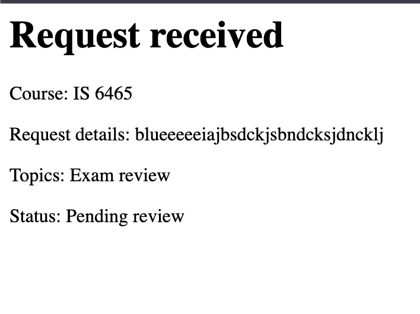

# Lab 4 Notes

## Part 1: Run the application

After I submitted a valid tutoring request, the application displayed
“Request received.” It showed my selected course, IS 6465, my entered
request details, the topic Exam review, and the status Pending review.
The confirmation page looked different from the styled request form.

## Part 2: Trace the templates

### What content does header.php provide to every page?

The header.php file provides the shared HTML document setup, including
the character encoding, mobile viewport settings, and the page title
“Peer Tutoring Hub.” It loads Bootstrap and the application's shared
stylesheet, then opens the body element.

### Where is the shared CSS file linked?

The shared CSS file is linked in the head section of includes/header.php
using <link rel="stylesheet" href="css/styles.css">.

### What content does nav.php provide?

The nav.php file provides a shared navigation bar with the site name
“Peer Tutoring Hub,” which links to index.php. It also includes a
“Requests” link to requests.php and a “Request a Session” link to
request-form.php.

### What content does footer.php provide?

The footer.php file displays “Peer Tutoring Hub” in a centered footer
with a top border. It also loads the Bootstrap JavaScript bundle and
closes the body and html elements.

### Why is require_once appropriate for these files?

The shared templates are required parts of the page. Using require_once
includes each file only once during the request, preventing duplicate
content if the same template is referenced again. PHP also stops
execution if a required template cannot be loaded.

## Part 3: Observe the form controls

### reason

The reason control is a textarea where the user describes what they
would like help with. It is required and allows up to 500 characters
in the browser. PHP receives the entered text as a single string
through $_POST['reason'].

### topics[]

The topics[] checkboxes let the user select multiple tutoring topics.
PHP receives the selected values as an array of strings through
$_POST['topics']. If no topics are selected, the browser does not
send this field.

### preferredtime

The preferredtime radio buttons let the user choose one time:
Morning, Afternoon, or Evening. PHP receives the selected value
as a single string through $_POST['preferredtime']. The required
attribute tells the browser that a selection is needed.

### preferreddate

The preferreddate control lets the user choose a preferred session
date. PHP receives the date as a single string in YYYY-MM-DD format
through $_POST['preferreddate']. The required attribute tells the
browser that a date must be entered.

### form_name

The form_name control is a hidden input that identifies the submitted
form. PHP receives the fixed value "tutoring_request" as a single
string through $_POST['form_name']. The control is not visible on
the page.

## Part 4: Test validation behavior

### Test 1: Valid request

I selected IS 6465, October 31, 2026, Exam review, and Afternoon.
I entered “I need help reviewing PHP form controls.” as the reason.

The request was accepted. The application displayed “Request received”
and “Status: Pending review,” along with my course, reason, and topic.

The business rule being checked was that the request contains a valid
course and time, a reason, at least one topic, and a date that is today
or in the future.

### Test 2: Missing required value

I selected IS 6465, October 31, 2026, and Afternoon. I entered
“I need help reviewing PHP form controls.” as the reason and left
all topic checkboxes unchecked.

The request was rejected. The application displayed “Request could
not be submitted” and “Select at least one valid topic.”

The business rule being checked was that at least one valid tutoring
topic must be selected. The server enforced this rule even though
the browser allowed the form to be submitted without a topic.

### Test 3: Past date

I selected IS 6465, October 29, 2026, Exam review, and Afternoon.
I entered “I need help reviewing PHP form controls.” as the reason.

The request was rejected. The application displayed “Request could
not be submitted” and “Preferred date cannot be in the past.”

The business rule being checked was that the preferred date must
be today or a future date. October 29 was before the testing date
of October 30, 2026.

## Part 5: Review testing and CRUD pages

### Validation test results

All 10 validation test cases displayed PASS: Valid time, Missing time,
Altered value, Multiple valid topics, Missing topics, Altered topic,
Minimum length, Maximum length, Too short, and Too long.

These results show that the tested validation functions handled
the valid and invalid inputs as expected.

### What query parameter appears in the request details URL?

The URL is request-details.php?request_id=12. The request_id query
parameter identifies the request to display, which is request 12.

### Why is a GET query parameter appropriate for viewing one request?

GET is appropriate because viewing a request retrieves information
without changing it. Including the request ID in the URL also allows
the details page to be bookmarked or linked to directly.

### CRUD pages

| CRUD action | Page |
|---|---|
| Create | request-form.php |
| Read one request | request-details.php |
| Read all requests | requests.php |
| Update | edit-request.php |
| Delete | delete-request.php |

The create form submits to process-request.php for validation and
processing. The edit and delete pages represent previews of those actions.

### Why should an actual update or delete later use POST rather than GET?

An actual update or delete changes application data, so it should use
POST rather than GET. GET requests should only retrieve information.
Using POST helps prevent changes from being triggered by following
a link, prefetching, or an automated crawler.

### Edit and delete page observations

The edit page displayed a form with request 12's existing values
already filled in so they could be revised.

The delete preview displayed “Cancel request 12?” with the choices
“Keep request” and “yes, cancel request.”