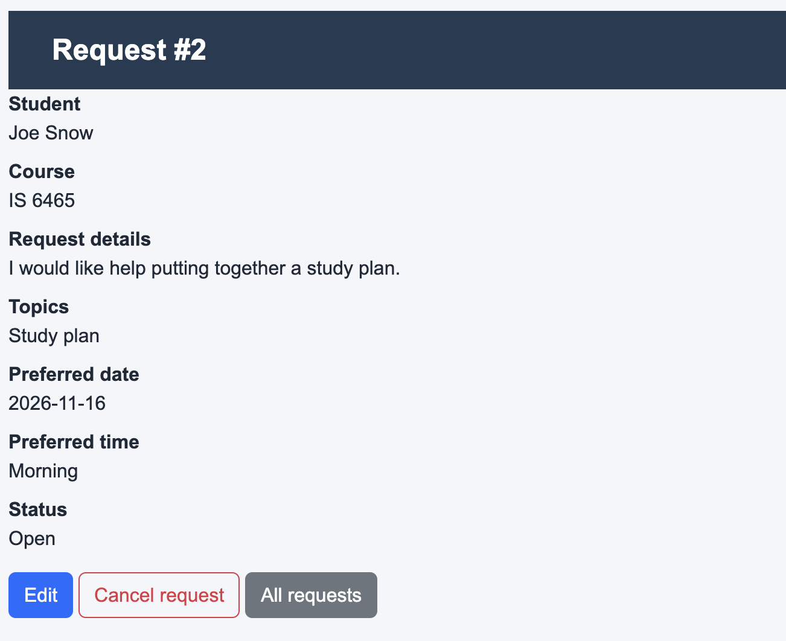

## Project links

Codespaces: https://shiny-barnacle-5gv9rvr7v9vgf74jw.github.dev/

# Lab 6 Notes

## Part 1: Set up the database

### Database setup command

```bash
sqlite3 database/tutoring.db < database/setup-database.sql
```

### Table verification

```bash
sqlite3 database/tutoring.db ".tables"
```

```text
students           tutoring_requests
```

I ran the setup script from the `lab6` folder and confirmed that both tables appeared.

## Part 2: Run the application

### Request detail page

Browser URL: https://shiny-barnacle-5gv9rvr7v9vgf74jw-8000.app.github.dev/php/request-details.php?request_id=2

I submitted a test tutoring request for Joe Snow in IS 6465. The application saved it as Request #2 and displayed the topic **Study plan**, the preferred date **November 16, 2026**, the preferred time **Morning**, and the status **Open**.

### Screenshot of the saved request



## Part 3: Test the application workflows

| Test | What I Did | Expected Result | Actual Result | Pass or Fail |
|---|---|---|---|---|
| Submit a valid request | Submitted a test request for IS 6465. | A new request is created with status Open. | The detail page showed Request #2 with status Open. | Pass |
| View all requests | Clicked **All requests**. | Request #2 appears in the list. | Request #2 appeared. | Pass |
| Filter requests | Applied the **Open** and **Cancelled** filters after cancelling Request #2. | Each filter shows requests with the selected status. | Request #2 disappeared under **Open** and reappeared under **Cancelled**. | Pass |
| Edit an Open request | Changed the preferred time from Morning to Afternoon and saved. | The detail page shows the revised time. | The detail page showed Afternoon. | Pass |
| Cancel an Open request | Clicked **Cancel request** and confirmed. | The request status changes to Cancelled. | Request #2 showed status Cancelled. | Pass |
| Try to edit or cancel a cancelled request | Checked the available actions on the detail page after cancelling Request #2. | The detail page offers no edit or cancel action for a cancelled request. | Both **Edit** and **Cancel request** were gone. | Pass |

## Part 4: Trace the request submission workflow

### Which file displays the tutoring request form?

`php/request-form.php` displays the form.

### Which file receives the submitted form data?

`php/process-request.php` receives the submitted form data. The form specifies `action="process-request.php"` and `method="post"`.

### Which file opens the PDO connection to SQLite?

`config/db.php` opens the PDO connection to SQLite. `php/process-request.php` loads it with `require_once __DIR__.'/../config/db.php';`. The `../` goes up from `php/` to the `lab6` folder.

### Which file coordinates validation and the database transaction?

`services/requestService.php` coordinates validation and the database transaction through `submitRequest()`. The controller in `php/process-request.php` calls `submitRequest(openDatabase(), $_POST)`, passing the PDO connection and submitted form data. When the service returns the saved request ID, the controller uses it to redirect the browser to the request detail page.

### Which files contain the SQL statements?

`repositories/studentPDO.php` contains the SQL for finding and inserting students. `repositories/requestPDO.php` contains the SQL for creating, retrieving, editing, and cancelling tutoring requests.

### Which table stores student information?

`students` stores each student’s ID, name, and email.

### Which table stores tutoring requests?

`tutoring_requests` stores the requests, including the course, topic, preferred date and time, and status.

### How does a tutoring request connect to the student who submitted it?

Each request stores a `student_id` foreign key that references `students.student_id`. One student can submit multiple requests, and each request links to its student through that ID.

### Why does SQL belong in repository files?

Keeping SQL in the repositories gives the service reusable functions for working with the database. The form page can focus on displaying the form, while the service handles validation and coordinates the transaction. This makes database queries easier to find and test.

## Part 5: Run the integration tests

### Test command

```bash
php tests/integration-tests.php
```

### Complete test output

```text
Xdebug: [Step Debug] Could not connect to debugging client. Tried: localhost:9000 (through xdebug.client_host/xdebug.client_port) :-(
PASS UC01 create and Open
PASS Lab 4 checkbox values preserved
FAIL Duplicate email reuses student
FAIL UC02 course and status filter
PASS Invalid reason rejected
FAIL Invalid submission writes nothing
PASS Edit Open request
PASS Updated reason persisted
PASS Cancel Open request
PASS Cancelled row retained
PASS Second cancellation rejected
PASS Unrelated request unchanged
PASS FK enforced
PASS UC02 empty filter result
FAILURES: 3
```

### Why did three checks fail?

The integration test loaded `database/setup-database.sql` into an in-memory SQLite database. The setup script inserted one sample student and one Open IS 6465 request before the test submitted its own requests. Three assertions expected counts for an initially empty database, so the seed records made each observed count one higher than expected.

## Part 6: Use the AI Skills Pack process

### Application Builder

**Prompt**

Explain how a tutoring request moves from `php/request-form.php` through PHP, PDO, and SQLite in this project. Identify the responsibility of each file.

**AI response**

`php/request-form.php` displays the form and sends its values by POST to `php/process-request.php`. The controller checks the request method and form name, then passes the submitted values and the PDO connection from `config/db.php` to `submitRequest()` in `services/requestService.php`.

The service validates the input with help from `includes/validation.php`. It starts a transaction, uses `repositories/studentPDO.php` to look up or create the student, and uses `repositories/requestPDO.php` to insert a request linked to that student's ID. The service commits both operations together, or rolls back if an operation fails. It returns the new ID so the controller can redirect to `php/request-details.php`, which displays the saved request.

**My evaluation**

I verified that `submitRequest()` in `services/requestService.php` validates the input before starting the transaction with `$pdo->beginTransaction()`. Inside the transaction, it finds or creates the student and passes the student’s ID to `insertTutoringRequest()`. It calls `$pdo->commit()` after the request is inserted. If an exception occurs while the transaction is active, it calls `$pdo->rollBack()`. This prevents a failed request insert from leaving behind a student record created during that submission.

### Traceability Auditor

**Prompt**

Trace the requirement “a student can submit a tutoring request” through the PHP files, service, repositories, SQLite tables, and integration tests in this project.

**AI response**

The form in `php/request-form.php` sends a POST to `php/process-request.php`. The controller calls `submitRequest()` in `services/requestService.php`. The service validates the input, then uses `studentPDO.php` to find or create the student and `requestPDO.php` to save a request linked to that student. The integration test retrieves the saved request and checks that its status is `Open`.

**My evaluation**

I checked `submitRequest()` and confirmed that it passes the student’s ID to `insertTutoringRequest()`. I also checked `tests/integration-tests.php` and confirmed that the `UC01 create and Open` assertion looks up the request by the returned ID and checks its status. My test run printed `PASS UC01 create and Open`.

| Requirement | Application Page | Service or Validation | Repository or SQL | Database Table | Test Evidence |
|---|---|---|---|---|---|
| Student submits a tutoring request | `php/request-form.php` posts to `php/process-request.php` | `submitRequest()` validates input and coordinates the transaction in `services/requestService.php` | `studentPDO.php` finds or creates the student, and `requestPDO.php` inserts the linked request | `students` and `tutoring_requests`, linked by `student_id` | `tests/integration-tests.php` retrieves the saved request by ID and verifies `Open`. Actual result: `PASS UC01 create and Open`. |

### Test Harness Generator

**Prompt**

Suggest one useful test case for the Peer Tutoring Hub application. The test must relate to request creation, filtering, editing, cancellation, validation, or database integrity.

**AI response**

Test that an invalid request from a new student leaves both database tables unchanged. In the in-memory test database, record the row counts for `students` and `tutoring_requests`. Submit a sample with an unused email address and a reason that is too short. Check that `submitRequest()` throws an `InvalidArgumentException`, then confirm that both counts match their original values.

**My evaluation**

The current integration test already checks that a short reason is rejected and checks the total request count afterward. It expects exactly two requests, so the starter’s seeded request makes that check fail. I would add the suggested test to `tests/integration-tests.php` and compare the counts before and after the invalid submission. Using an unused email also checks that the rejected submission cannot leave behind a new student record. This test is appropriate because rejection should leave both tables unchanged.

### Skills Pack reflection

AI helped me trace how the PHP form, service, and repositories work together to save a tutoring request. When I checked the code, I saw that the integration tests loaded a sample student and request before submitting their own test data. The terminal showed that the row count checks failed, and the code explained why the counts were higher than expected. Developers should verify AI explanations against the actual code and requirements so they can tell whether a failure comes from the application or from an assumption in the test.

## Part 7: Inspect the database

### What does the JOIN do?

The JOIN matches `tutoring_requests.student_id` to `students.student_id`. This lets the query show each request’s details alongside the name and email of the student who submitted it.

### What did the query show?

Request #2 was linked to Joe Snow. It still appeared in the query results with a preferred time of Afternoon and a status of Cancelled. This confirms that the edit was saved and that cancellation kept the request in the database.
