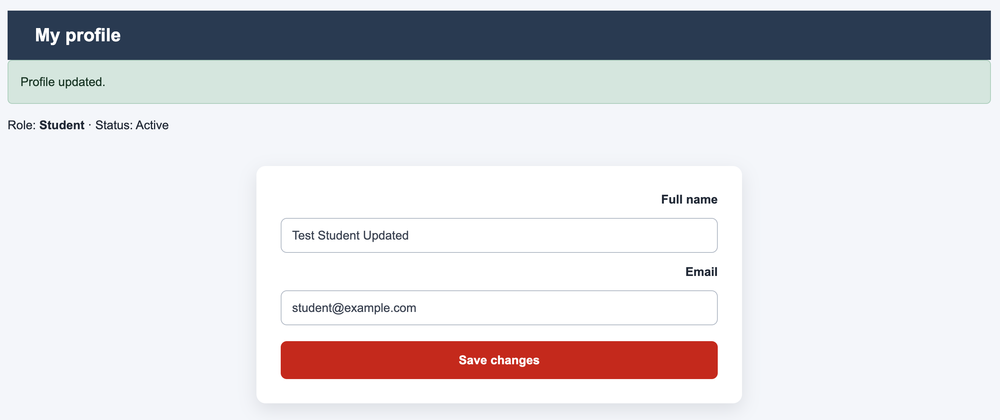
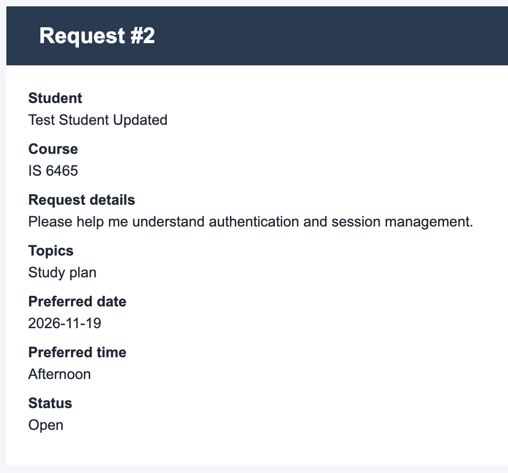
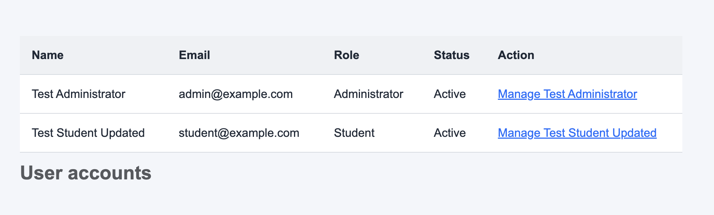

# Lab 7 Notes

Prepared with AI assistance from Codespaces output and screenshots collected on November 18, 2026. Administrator logout was confirmed: directly revisiting /php/users.php returned to login. Final review, GitHub save, and Canvas submission remain.

Codespaces link: https://shiny-barnacle-5gv9rvr7v9vgf74jw.github.dev/

## Part 1 Generate the application

### Implementation prompt

Generate code for all user management use cases UM-01 through UM-10 in the User Management Design Document.

Use the Application Builder, Test Harness Generator, and Traceability Auditor documents as implementation guidance. Follow the authentication, authorization, session management, password hashing, CSRF protection, and role based access practices in the Authentication Reading Handout.

Use lab6.zip as the existing Peer Tutoring Hub application to extend. Preserve the Lab 6 three tier architecture and update the application as needed to support user registration, login, logout, profile management, administrator access, and protected tutoring request workflows.

Return a complete Lab 7 application package with all updated and new files.

### Supplied source materials

- lab6.zip
- Peer_Tutoring_Hub_User_Management_With_Diagrams.docx
- IS6465_Authentication_Reading_Handout_v1.2_[16Nov2026].pdf
- skills pack.zip: application-builder.txt, test-harness-generator.txt, traceability-auditor.txt
- Supporting lecture: IS6465_Week8_Authentication_Lecture_v2.1[16Nov2026].pdf
- Canvas assignment and supplied lecture/coding-companion transcripts

### How Lab 7 extends Lab 6

Lab 7 adds a users table and a unique students.user_id link, account registration and profile management, password hashing, login/logout, session checks, role-based access, CSRF protection, and student ownership checks. Pages still handle presentation and submitted requests, services handle validation and business workflows, repositories hold PDO/SQL, and config/db.php creates the connection.

### Code verification example

Suggested example to inspect: includes/auth.php requireLogin reloads the current user, checks Active status and a 1200-second timeout, then refreshes server-session identity. This matches the reading's shared session guard.

Code verification: In includes/auth.php, requireLogin checks for user_id, applies a 1200-second inactivity limit, calls findUserById, denies missing or Inactive accounts, and refreshes display_name and role. The student logout/direct-URL check also returned to login. The timeout and inactive-account browser paths were not manually exercised.

## Part 2 Database setup

From lab7/database:

```bash
sqlite3 -bail tutoring.db < setup-database.sql
sqlite3 -bail tutoring.db < upgrade-to-user-management.sql
sqlite3 tutoring.db ".tables"
```

The -bail option stops on SQL errors; the input scripts are the ones specified by the lab. Run the upgrade once on a new Lab 7 database.

Actual table output:

```text
students           tutoring_requests  users
```

All three required tables appeared after the two setup commands completed.

## Part 3 Administrator account

Command structure (password deliberately omitted):

```text
php create-admin.php "Test Administrator" admin@example.com "[password omitted]"
```

Test administrator email: admin@example.com

Assigned role: Administrator, confirmed in the Manage users screenshot and database query.

Actual creation output:

```text
Xdebug: [Step Debug] Could not connect to debugging client. Tried: localhost:9000 (through xdebug.client_host/xdebug.client_port) :-(
Administrator created.
```

Do not include the actual password.

## Part 4 Run the application

From lab7:

```bash
php -S 0.0.0.0:8000 php/router.php
```

The router adds protection for internal database/source files to the assignment's PHP server command.

Forwarded application URL captured on the administrator page: https://shiny-barnacle-5gv9rvr7v9vgf74jw-8000.app.github.dev/php/users.php

The application opened successfully in the browser.

The first visit displayed the login page. After registering and logging in as the Student, My profile appeared.

The Codespace reported PHP 7.4.33, Zend Engine 3.4.0, and Xdebug 3.1.6. Every PHP file passed php -l. php -m confirmed PDO, pdo_sqlite, sqlite3, mbstring, and session. The generated README originally targeted PHP 8; these syntax checks and the recorded tests were actually run on PHP 7.4.33.

Commands:

```bash
php -v
find . -name '*.php' -print0 | xargs -0 -n1 php -l
php -m
```

## Part 5 Student workflow

| Test | What I Did | Expected Result | Actual Result | Pass or Fail |
|---|---|---|---|---|
| Register student account | Registered Test Student with student@example.com and Student role. | Student account is created | Registration returned to login; the account subsequently logged in. | Pass |
| Log in as student | Entered the registered test credentials. | Protected student pages are accessible | My profile appeared. | Pass |
| View or update profile | Changed the name to Test Student Updated and saved. | Profile information is displayed or saved | Profile updated appeared with the new name, Student role, and Active status. | Pass |
| Create tutoring request | Requested IS 6465, Study plan, November 19, 2026, Afternoon, with a reason about authentication and session management. | New request has status Open | Request #2 displayed the submitted details and Open status. | Pass |
| Edit Open request | Changed Request #2 preferred time from Afternoon to Evening and saved. | Updated request information is displayed | The updated request details showed Evening. | Pass |
| View my requests | Opened My requests. | Student sees only their own requests | Request #2 appeared; no other students' requests appeared. | Pass |
| Log out | Selected Log out, then entered /php/requests.php directly. | Session ends and login page appears | The protected URL returned to login. | Pass |

Student profile screenshot:



Request #2 immediately after creation, before its time was changed to Evening:



## Part 6 Administrator workflow

Logged in as admin@example.com and opened Manage users. The list displayed Test Administrator and Test Student Updated, both Active, with their respective roles. All requests displayed both sample Request #1 and the student's Request #2, confirming access beyond one student account.

Administrator logout: logged out and directly revisited /php/users.php. The application returned to login, confirming that the administrator page was protected after logout.

Administrator user-list screenshot:



### Authentication and authorization

Authentication and authorization explanations:

- Authentication verifies an Active user's email and password with authenticateUser and establishes a server session.
- Authorization checks what that user may do using requireRole and student ownership conditions in SQL.
- A Student sees and manages their own Open requests. An Administrator can view all requests, edit/cancel Open requests, and manage users. Administrators do not submit requests as students.
- User search, inspecting another account, role changes, account activation/deactivation, and requesting account deletion should be administrator-only.
- After logout, a direct visit to a protected page should redirect to login because the session identity is gone.

Observed direct-URL result after student logout: visiting /php/requests.php returned to the login page.

Source check: profile.php uses the current requireLogin result, users.php requires Administrator, and request-details.php passes requestOwnerScope to findRequest. A Student scope is their user_id; an Administrator scope permits all requests.

## Part 7 Trace registration and login

These answers describe the generated source. Review them against the actual uploaded files.

### Student registration

1. Form: php/register.php.
2. Receiver: the POST-handling section at the top of php/register.php.
3. CSRF: includes/auth.php provides csrfToken, validCsrfToken, and verifyCsrfToken. bootstrap.php starts the anonymous session; registration is public but its POST needs a matching token.
4. Validation service: services/userService.php registerUser calls createAccount, validateAccountFields, and validatePassword. Public roles are limited to Student/Tutor and duplicate email is rejected.
5. Password hashing: createAccount in services/userService.php uses password_hash with PASSWORD_DEFAULT before calling the repository.
6. Repositories: repositories/userPDO.php insertUser and repositories/studentPDO.php insertLinkedStudent.
7. Tables: a Student registration inserts users and students records in one transaction, linked through students.user_id. Tutor registration inserts only a users record.

Flow: Browser -> register.php POST -> CSRF verification -> userService.php -> userPDO.php and studentPDO.php -> PDO -> SQLite.

### User login

1. Form: php/login.php.
2. Receiver: the POST-handling section at the top of php/login.php.
3. Email lookup: repositories/userPDO.php findUserByEmail.
4. Password verification: services/userService.php authenticateUser calls password_verify and requires Active status.
5. Session actions: includes/auth.php establishLogin regenerates the ID, replaces the session values with user_id, display_name, role, and last_activity, creates a CSRF token, then login.php redirects to profile.php.
6. ID regeneration helps prevent session fixation: the authenticated session does not continue using the identifier known before login.
7. The role originates in users.role, is placed in the server session, and is reloaded from SQLite on every protected request by requireLogin.

Flow: Browser -> login.php POST -> CSRF verification -> authenticateUser -> findUserByEmail -> PDO/SQLite -> password verification -> establishLogin -> profile.php.

### Why hashing belongs in the application layer

The service validates credentials and applies the password policy as part of the account workflow. Keeping password_hash and password_verify there lets the pages focus on displaying forms and handling requests, and lets repositories focus on SQL. Setup SQL defines database structure rather than handling submitted passwords. The CLI administrator script reuses the same account service.

Source checks: register.php calls registerUser; createAccount hashes the password before insertUser and inserts the linked Student inside the same transaction. login.php calls authenticateUser followed by establishLogin. These source checks were performed with AI assistance; the Student registration/login workflow and the 40 passing user-management checks provide the execution evidence recorded below.

## Part 8 Automated tests

All three commands below were run from lab7 in Codespaces. The following is the complete command output supplied during the walkthrough, excluding shell prompts. The Xdebug warning appeared, but the test scripts continued. They were not run on the generating computer.

### Validation tests

```bash
php tests/validation-tests.php
```

Actual complete output:

```text
Xdebug: [Step Debug] Could not connect to debugging client. Tried: localhost:9000 (through xdebug.client_host/xdebug.client_port) :-(
<p>Valid time: PASS</p><p>Missing time: PASS</p><p>Altered value: PASS</p><p>Multiple valid topics: PASS</p><p>Missing topics: PASS</p><p>Altered topic: PASS</p><p>Minimum length: PASS</p><p>Maximum length: PASS</p><p>Too short: PASS</p><p>Too long: PASS</p>
```

Result: all 10 displayed validation checks passed. The script prints HTML paragraphs even in the terminal.

### User management tests

```bash
php tests/user-management-tests.php
```

Actual complete output:

```text
Xdebug: [Step Debug] Could not connect to debugging client. Tried: localhost:9000 (through xdebug.client_host/xdebug.client_port) :-(
PASS UM-01 registration creates an Active student
PASS Password stored as verifiable hash
PASS Student profile links to users.user_id
PASS Duplicate email rejected
PASS Email uniqueness is case insensitive
PASS Public administrator registration denied
PASS Password shorter than 12 characters denied
PASS Password confirmation mismatch denied
PASS Legacy student record cannot be claimed through registration
PASS Invalid registrations write no user records
PASS Tutor registration does not create student profile
PASS Tutor request workflow denied
PASS UM-09 valid login verifies credentials
PASS Incorrect login password denied
PASS UM-03 administrator search repository filters accounts
PASS UM-04 account and student profiles update together
PASS Profile cannot change role
PASS Profile cannot take another account email
PASS UM-05 incorrect current password denied
PASS UM-05 new password works
PASS UM-05 previous password no longer works
PASS UM-06 nonadministrator role change denied
PASS UM-06 changing Tutor to Student creates linked profile
PASS UM-07 inactive account cannot log in
PASS Last active administrator cannot be demoted
PASS UM-08 deletion blocked by unresolved retention policy
PASS Blocked deletion retains account
PASS Request identity comes from authenticated account
PASS Student cannot read another student request
PASS Student request list excludes other owners
PASS Student cannot update another student request
PASS Student cannot cancel another student request
PASS Administrator can view another student request
PASS Owner can edit own Open request
PASS Owner can cancel own Open request
PASS Cancelled request cannot be edited
PASS Login regenerates session ID and stores identity
PASS Missing and invalid CSRF tokens rejected
PASS Valid CSRF token accepted
PASS UM-10 logout clears server session
Results: 40 passed, 0 failed
```

Result: 40 passed, 0 failed.

### Integration tests

```bash
php tests/integration-tests.php
```

Actual complete output:

```text
Xdebug: [Step Debug] Could not connect to debugging client. Tried: localhost:9000 (through xdebug.client_host/xdebug.client_port) :-(
PASS UC01 create and Open
PASS Lab 4 checkbox values preserved
FAIL Duplicate email reuses student
FAIL UC02 course and status filter
PASS Invalid reason rejected
FAIL Invalid submission writes nothing
PASS Edit Open request
PASS Updated reason persisted
PASS Cancel Open request
PASS Cancelled row retained
PASS Second cancellation rejected
PASS Unrelated request unchanged
PASS FK enforced
PASS UC02 empty filter result
FAILURES: 3
```

Result: 11 checks passed and 3 checks failed. This test group did not pass.

| Failed test name | What it checked | Investigation or explanation |
|---|---|---|
| Duplicate email reuses student | Two submissions with the same email should use one student record. | The assertion expects one student total, but setup inserts Maria Lopez before the test creates Jordan Lee. The expected total is therefore two; the count assertion does not isolate duplicate-email reuse. |
| UC02 course and status filter | Filtering IS 6465 and Open should return matching requests. | The assertion expects two requests, but the seeded Open IS 6465 request also matches, making three. Review the fixture baseline and expected count. |
| Invalid submission writes nothing | An invalid reason should not insert a request. | The assertion expects two total requests after rejection, but three already exist including the seed. The rejection check passes; a before/after count would test the no-write requirement without assuming an empty baseline. |

The actual three failures match the fixture mismatch identified in the supplied setup SQL and test assertions. The test code uses sqlite::memory: and loads setup-database.sql, so it includes the seed records independently of the working application database. Both supplied test files remain unchanged. A future instructor-authorized correction should reconcile fixture counts or use before/after assertions; the failed checks are documented here rather than hidden.

## Part 9 AI Skills Pack process

### Application Builder

Prompt: Explain how a student registration request moves from register.php through authentication checks, PHP services, repositories, PDO, and SQLite in the Peer Tutoring Hub application. Identify the responsibility of each file or layer.

AI response: register.php displays the form and also receives its POST. bootstrap.php loads the database connection, services, and session helpers. Registration does not require login because it creates an account; verifyCsrfToken checks the anonymous session's token. registerUser delegates validation and transaction work to createAccount in userService.php. That service hashes the password and calls insertUser in userPDO.php; for a Student, insertLinkedStudent in studentPDO.php inserts the linked profile. Prepared PDO statements write both records to SQLite, and the service commits them together or rolls back. The page redirects to login after success.

Evaluation: The claim that Student registration creates both records in one transaction is supported by createAccount in services/userService.php: beginTransaction precedes insertUser and insertLinkedStudent, and commit follows both; the exception path rolls back. The executed tests reported PASS for the Student profile link and rejected invalid registrations without extra users. Registration is public, so it would be inaccurate to say this page requires an existing authenticated login.

### Traceability Auditor

Prompt: Trace the requirement “a student can register, log in, create a tutoring request, and log out” through the presentation pages, authentication code, services, repositories, SQLite tables, and automated tests in this project.

AI response and draft matrix:

| Requirement | Presentation Page | Authentication or Authorization | Service or Validation | Repository or SQL | Database Table | Test Evidence |
|---|---|---|---|---|---|---|
| Student registers an account | php/register.php | Public Student/Tutor allowlist; verifyCsrfToken | registerUser / createAccount; validateAccountFields / validatePassword | insertUser / insertLinkedStudent | users, students | user-management-tests.php account/hash/link/duplicate/role checks passed in the 40/40 suite; manual Student registration also succeeded |
| Student logs in | php/login.php | establishLogin regenerates ID; Active status required | authenticateUser / password_verify | findUserByEmail | users | user-management-tests.php valid/invalid/inactive/password/session-ID checks passed in the 40/40 suite; manual Student login reached My profile |
| Student creates a tutoring request | php/request-form.php and php/process-request.php | requireLogin, Student role, CSRF, server-selected identity | submitAuthenticatedRequest / validateSubmission | findStudentByUserId / insertLinkedStudent / insertTutoringRequest | users, students, tutoring_requests | user-management-tests.php request identity and ownership checks passed in the 40/40 suite; manual Request #2 creation succeeded; legacy integration suite has the three documented fixture failures |
| User logs out | Navigation POST to php/logout.php | verifyCsrfToken / logoutSession | Clear values, expire cookie, destroy session | No database write | None changed | user-management-tests.php server-cleanup check passed; manual student logout followed by protected-URL access returned to login; browser cookie expiry was not separately inspected |

Evaluation: The matrix connects each requirement to named code and to executed evidence. The user-management suite passed 40 checks and the manual Student flow succeeded, but those results do not establish that every HTTP guard or browser cookie setting was separately tested. The legacy integration tests exercise the earlier request service and have three fixture-count failures, so they cannot be described as an entirely passing end-to-end authentication suite.

### Test Harness Generator

Prompt: Suggest one useful test case for authentication or authorization in the Peer Tutoring Hub application. The test must relate to registration, login, logout, session protection, role based access, password validation, CSRF protection, or account status.

AI response: Register two fictional Student accounts. Create a request as Student A. Log in as Student B and navigate directly to request-details.php?request_id=[A's request ID]. Expect a 404 without A's name, email, or request contents. Also try a POST to update-request.php using A's request ID and B's valid CSRF token; expect 404 and verify A's request is unchanged.

Coverage: user-management-tests.php covers the repository read and scoped service update/cancellation denial using two owners. It does not send real HTTP requests through requireLogin or assert the HTTP response. The manual steps above cover that missing page/controller boundary.

Evaluation: This is appropriate because students may access only their own requests, and changing a URL ID must not bypass that rule. The proposed manual test would use a second fictional Student account, capture the actual HTTP response, and compare the saved request before and after the forged update. That extra two-account browser test was not performed in this walkthrough. The executed automated suite did report PASS for rejecting another student's read, update, and cancellation through the scoped repository/service paths. No supplied test file was changed.

### Reflection

AI helped generate the Lab 7 application and organize the setup, workflow checks, and test output. Its explanations connect the browser pages to services, repositories, and SQLite, which makes the registration and login paths easier to follow. The integration failures show why generated code and explanations need to be checked against the actual test fixtures and requirements. Passing automated tests provide useful evidence, but developers must also check access behavior in the browser and investigate failures rather than assume the application is correct.

## Part 10 Inspect the database

From lab7:

```bash
sqlite3 database/tutoring.db
```

```sql
SELECT
    u.user_id,
    u.full_name,
    u.email,
    u.role,
    u.status,
    s.student_id,
    s.student_name,
    s.student_email
FROM users AS u
LEFT JOIN students AS s
    ON u.user_id = s.user_id
ORDER BY u.user_id;
```

Actual query results (blank student columns indicate SQL NULL values):

```text
user_id  full_name             email                role           status  student_id  student_name          student_email
-------  --------------------  -------------------  -------------  ------  ----------  --------------------  -------------------
1        Test Administrator    admin@example.com    Administrator  Active
2        Test Student Updated  student@example.com  Student        Active  2           Test Student Updated  student@example.com
```

LEFT JOIN keeps every users row even when it has no matching student profile; the student columns are then NULL. The link is users.user_id = students.user_id, with a unique nullable foreign key on students.user_id. Account information includes credentials, role, and status, while student information supports tutoring requests linked through student_id. An administrator created directly by the CLI script does not need a student profile, so it can appear without a matching students row.

The output shows user #1 (Administrator) without a student row and user #2 linked to student #2. The separate seeded Maria Lopez student has no users row, so this users-led LEFT JOIN does not list that unlinked student.

```text
.quit
```
