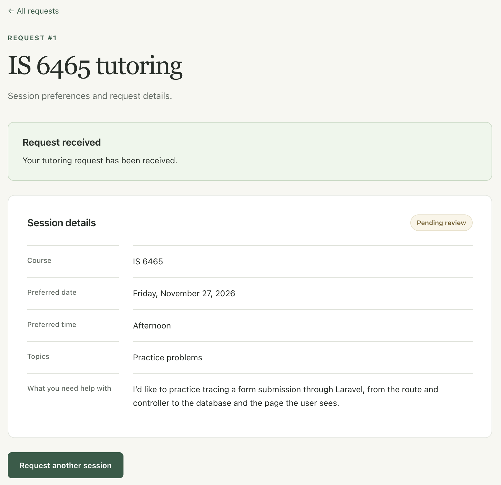

# Lab 8 — Laravel MVC Demo

Kyan Chase · IS 6465-090

## What the app does

Peer Tutoring Hub gives students a place to request help for a course. A student describes what they need help with, chooses topics and a preferred date and time, and submits the request. The demo saves valid requests to SQLite and lets users see the list and reopen a request. The date and time are preferences for the request, so the confirmation means the request was received.

## Where the MVC pieces are

Paths are relative to the Laravel `app/` folder in the starter repo.

| Area | File | What it does |
| --- | --- | --- |
| Route | `routes/web.php` | `POST /requests` is named `requests.store`. Clicking **Request session** on the form sends this request and Laravel calls the controller’s `store()` method. |
| Controller | `app/Http/Controllers/TutoringRequestController.php` | `store()` checks the submitted fields, creates the record, and redirects to its details page with a success message. `show()` passes the saved request to the details view. |
| Model | `app/Models/TutoringRequest.php` | `TutoringRequest` is the Eloquent model for a tutoring request. It represents the course, reason, topics, and date and time preferences. The model lets PHP work with topics as an array and the preferred date as a date object. |
| View | `resources/views/requests/show.blade.php` | The detail page shows the request number, course, status, preferences, topics, and reason. It shows **Request received** just after a successful submission and gives the user a link back to **All requests**. |

## Workflow — submitting and opening a request

1. The browser sends `POST /requests` when the student submits the form. The route dispatches it to `TutoringRequestController::store()`.
2. The controller checks rules such as having at least one topic, using a date of today or later, and writing a description between 10 and 500 characters. If validation fails, Laravel sends the student back to the form with the errors. The form uses their previous inputs so they can correct the problem.
3. On success, the controller calls `TutoringRequest::create()` with the validated fields. Eloquent inserts a row into SQLite and returns the saved model.
4. The controller redirects the browser to the named `requests.show` route. The browser makes a second request, `GET /requests/{tutoringRequest}`, with the new ID in the URL. Laravel uses route model binding to look up that row and gives the model to `show()`.
5. `show()` returns `requests.show`. Blade turns the saved request and the one-time success message into the HTML confirmation page.

## Comparison to Craving Index

Our Craving Index project uses direct PHP pages and shared includes. For example, `/restaurants/view.php?id=1` points to the restaurant details script itself, which loads the shared header and navigation and renders the page. The Lab 7 structure also gives the final project a place for business rules in services and SQLite queries in repositories. In Laravel, I can start from a single route file, find the controller action, and follow it to the model and the Blade view. That gives the team a predictable way to find request-handling code. Keeping the Lab 7 structure gives us more time to finish the required features and test database access and permissions without spending the rest of the course moving working pages into a new framework.

## Running app evidence

## Reflection

Tracing the form made it easier for me to see where the request handling ends and where the HTML starts. I could read the validation rules in the controller, then open the Blade file and see exactly which information goes on the page. Route model binding was the part that took a second to click. The `show()` method already has a `TutoringRequest` object even though there’s no query inside that method. Looking at the route parameter and the controller argument together helped me understand how Laravel finds the row before the method runs.

[Laravel demo source](https://github.com/chinmaythorat92/peer-tutoring-laravel-demo) · [Craving Index restaurant details page](https://github.com/jamisonorton/6465-restaurant/blob/main/restaurants/view.php)
